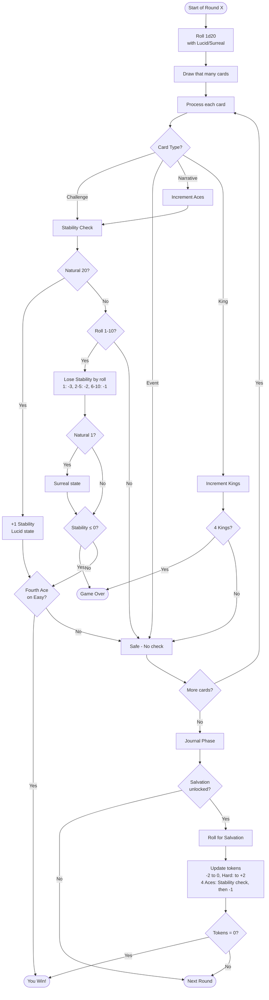

# D20 Solo RPG System - Mechanics Guide

## Digital Implementation Reference

**Version:** 3.2 (D20 System, three difficulties; the fourth Ace ends the game on Easy only)
**Date:** 2026-11-07
**Purpose:** Complete D20 mechanics specification for implementation and testing
**System:** D20-based tactical solo journaling RPG inspired by Wretched and Alone

---

## Table of Contents

1. [System Overview](#1-system-overview)
2. [Core Resources](#2-core-resources)
3. [D20 Rolling Mechanics](#3-d20-rolling-mechanics)
4. [Salvation System (Win Condition)](#4-salvation-system-win-condition)
5. [Card Types](#5-card-types)
6. [Game Flow](#6-game-flow)
7. [Win & Loss Conditions](#7-win--loss-conditions)
8. [Balance & Probabilities](#8-balance--probabilities)
9. [Implementation Details](#9-implementation-details)

---

## 1. System Overview

### 1.1 Core Philosophy

The D20 Solo RPG System is a **tactical solo journaling RPG** that combines:

- **Strategic Depth**: Lucid/Surreal states create meaningful tactical choices
- **Three Difficulties**: Easy can be won often; Normal is a long shot; Hard keeps the SRD's "almost never" win rate (see 7.3)
- **Narrative Emergence**: Story emerges through card prompts and journaling
- **Fair Challenge**: on Normal tokens only ever fall, so every Salvation roll is progress; on Easy the fourth Ace is a real way out; on Hard winning is under 1%
- **Dual-Phase Structure**: Action phase + reflection phase

### 1.2 Key Differences from d6 System

**D20 System Changes:**

- Uses d20 (1-20) instead of d6 (1-6) for all rolls
- Stability checks instead of tower pulls
- Graduated token changes (-2 to 0 on Normal; -2 to +2 on Hard) instead of binary success/failure
- Lucid (advantage) and Surreal (disadvantage) states
- Ace-dependent Salvation thresholds
- No final damage roll (victory when tokens = 0, or on Easy when the fourth Ace's Stability check is survived)

### 1.3 Play Time

- **Typical Game:** 30-45 minutes
- **Short Game:** 15-25 minutes (lucky Ace draws)
- **Long Game:** 60-90 minutes (unlucky Salvation rolls)

---

## 2. Core Resources

### 2.1 Stability (Your Life)

```
STABILITY: 20 → 0

States:
- 20-15: Stable (green)
- 14-10: Strained (yellow)
- 9-5:  Critical (orange)
- 4-1:  Desperate (red)
- 0:    FAILURE (game over)
```

**Properties:**

- Starting value: 20
- Lost through failed Stability checks (Challenge cards)
- Can be gained: Natural 20 on Stability check grants +1 (max 20)
- Reaches 0 → Instant loss

### 2.2 Tokens (Path to Victory)

```
TOKENS: 10 → 0

Goal: Remove all tokens to win
Unlocked by: Drawing Ace of Hearts (Salvation)
```

**Properties:**

- Starting value: 10 (when Salvation unlocked)
- Changed through Salvation checks (d20 rolls)
- Changes based on roll (Normal; Hard in brackets):
  - Natural 20: -2 tokens (critical success)
  - At/above threshold: -1 token (success)
  - Below threshold: no change (Hard: +1 token)
  - Natural 1: no change, and Surreal (Hard: +2 tokens)
  - Four Aces: -1 token after a Stability check, if Stability holds (see 4.2)
- On Normal tokens only ever fall: they can never rise above the start
- Reaches 0 with Stability > 0 → Victory

### 2.3 Aces Revealed (Abilities)

```
ACES: 0 → 4

Each Ace improves Salvation success rate
```

**Properties:**

- Starting value: 0 (1 in easy mode)
- Incremented when Narrative cards (Aces) are drawn
- Determines Salvation threshold:
  - 1 Ace: Threshold 17 (20% success rate)
  - 2 Aces: Threshold 14 (35% success rate)
  - 3 Aces: Threshold 11 (50% success rate)
  - 4 Aces: threshold 0 (no target: one Stability check, then -1 token if Stability holds). Easy: no Salvation roll, the fourth Ace ends the game first (see 4.4)

---

## 3. D20 Rolling Mechanics

### 3.1 Standard Roll

```javascript
// Roll 1d20 (1-20)
const roll = rollDie(20);
```

**Used for:**

- Round start (determines cards to draw)
- Stability checks (Challenge cards and Aces; on Easy the fourth Ace's check decides the game, see 4.4)
- Salvation checks (token removal attempts; with four Aces, a Stability check)

### 3.2 Lucid State (Advantage)

```
LUCID = Advantage
Roll 2d20, keep highest

Trigger: Natural 20 on any d20 roll (opening roll, Roll for Tasks, Stability check, Salvation)
         On 2d20, only the kept die counts
Duration: Next roll only (consumed on use)
```

**Example:**

```javascript
// Lucid state: Roll 2d20, keep higher
const roll1 = 8;
const roll2 = 15;
const result = Math.max(roll1, roll2); // 15
```

**Strategic Value:**

- Significantly improves next check success rate
- Can turn a likely failure into a likely success
- Creates tactical decision: "When should I attempt Salvation?"

### 3.3 Surreal State (Disadvantage)

```
SURREAL = Disadvantage
Roll 2d20, keep lowest

Trigger: Natural 1 on any d20 roll (opening roll, Roll for Tasks, Stability check, Salvation)
         On 2d20, only the kept die counts
Duration: Next roll only (consumed on use)
```

**Example:**

```javascript
// Surreal state: Roll 2d20, keep lower
const roll1 = 8;
const roll2 = 15;
const result = Math.min(roll1, roll2); // 8
```

**Strategic Risk:**

- Significantly worsens next check success rate
- Can turn a likely success into a likely failure
- Creates tension: "Can I survive until this clears?"

### 3.4 State Priority

**Important:** Only ONE state can be active at a time.

```javascript
// State resolution order
if (isLucid) {
	// Roll with advantage, clear Lucid
	isLucid = false;
	isSurreal = false;
} else if (isSurreal) {
	// Roll with disadvantage, clear Surreal
	isSurreal = false;
	isLucid = false;
}
```

**Edge Cases:**

- If Lucid and you roll natural 1 → Lose Lucid, gain Surreal
- If Surreal and you roll natural 20 → Lose Surreal, gain Lucid
- On 2d20, only the kept die counts: Lucid rolling 1 and 14 keeps 14, so it is not a natural 1
- States do NOT stack (can't have Lucid + Surreal)

---

## 4. Salvation System (Win Condition)

### 4.1 Unlocking Salvation

**Trigger:** Draw Ace of Hearts (Primary Success card)

**Effects:**

```
1. Set aceOfHeartsRevealed = true
2. Set tokens = 10
3. Enable Salvation checks at end of each round
4. Increment acesRevealed (affects threshold)
```

### 4.2 Salvation Thresholds

```
Aces | Threshold | Success on | Win Rate | Probability
-----|-----------|------------|----------|------------
  1  |    17     | 17-20      |   20%    | Very Hard
  2  |    14     | 14-20      |   35%    | Hard
  3  |    11     | 11-20      |   50%    | Medium
  4  |  (none)   | see below  |    -     | A Stability check, then the token* (Easy: the fourth Ace ends the game first, 4.4)
```

\* With four Aces there is no target, but the token only comes off after one Stability check.
The roll (with any Lucid or Surreal, which it uses up) is read on the Stability table: natural 1
is -3 Stability and Surreal, 2-5 is -2, 6-10 is -1, 11-19 is no loss, natural 20 is +1 (max 20)
and Lucid. If Stability is still above 0, the token comes off (-1). If the roll takes Stability
to 0, the game is lost by Stability instead. See `calculateAutomaticSalvation()`. This is how
Normal and Hard play with four Aces; on Easy this step is never reached, because the fourth Ace
ends the game first.

**Calculation:**

```javascript
function getSalvationThreshold(acesRevealed) {
	const thresholds = [20, 17, 14, 11, 0];
	return thresholds[Math.min(acesRevealed, 4)];
}
```

### 4.3 Salvation Check Resolution

```javascript
// calculateSalvationResult(roll, threshold, { hard })
function resolveSalvationCheck(roll, threshold, hard) {
	// Natural 20: Critical success (and Lucid)
	if (roll === 20) {
		return { change: -2, type: 'critical_success' };
	}

	// Natural 1: a miss (and Surreal). Nothing on Normal, +2 tokens on Hard
	if (roll === 1) {
		return { change: hard ? +2 : 0, type: 'critical_failure' };
	}

	// Success
	if (roll >= threshold) {
		return { change: -1, type: 'success' };
	}

	// A miss: nothing on Normal, +1 token on Hard
	return { change: hard ? +1 : 0, type: 'failure' };
}
```

**Token Changes:**

| Roll       | Result           | Normal | Hard | Example (10 → ?)   |
| ---------- | ---------------- | ------ | ---- | ------------------ |
| Natural 1  | Critical Failure | 0      | +2   | 10 → 10 (Hard: 12) |
| < Thresh   | Failure          | 0      | +1   | 10 → 10 (Hard: 11) |
| ≥ Thresh   | Success          | -1     | -1   | 10 → 9             |
| Natural 20 | Critical Success | -2     | -2   | 10 → 8             |

**Strategic Depth:**

- On Normal a miss costs a round, not a token: tokens only ever fall
- On Hard natural 1s can make the game unwinnable (tokens keep increasing)
- Natural 20s provide crucial acceleration
- Creates meaningful tension in every Salvation roll

### 4.4 The Fourth Ace (Easy only)

On Easy the fourth Ace ends the game. Being odd, it calls for a Stability check like every Ace,
and that check is the last roll of the game (`isFinalStabilityCheck()` in
`gameActions.svelte.js`: four Aces revealed, and `fourthAceWins(gameState)`, the one helper in
`src/lib/constants/difficulty.js` that says whether the fourth Ace ends the game; the card
note, the HUD and the rule captions read the same helper):

- Any Lucid or Surreal applies to the roll and is used up by it, like any roll. The roll is read
  on the normal Stability table (5.5).
- Stability still above 0 afterwards → the game is won at once, whatever tokens remain
  (`winGame()`). No more cards are drawn that round and there is no Salvation step. The ending's
  cause line reads "The fourth Ace was revealed."
- Stability at 0 → the game is lost by Stability, as on any fatal roll.
- A fourth Ace carrying `skip-damage` skips the check, as the card promises, so the player wins
  outright (`confirmCard()`).
- The result never moves on by itself: the button reads "Escape" (or "Face the end") and waits.

On Normal and Hard the fourth Ace ends nothing: Salvation goes on as a Stability check per
token (4.2), and the game is won only by the last token.

---

## 5. Card Types

### 5.1 Card Type Distribution

```
Total Cards: 52

Type              | Ranks          | Count | Percentage
------------------|----------------|-------|------------
Primary Success   | A♥            | 1     | 2%
Narrative         | A♦, A♣, A♠    | 3     | 6%
Failure Counter   | K♥, K♦, K♣, K♠| 4     | 8%
Challenge         | 3,5,7,9 (all) | 16    | 31%
Event             | 2,4,6,8,10,J,Q| 28    | 53%
```

### 5.2 Primary Success (Ace of Hearts)

**Card:** A♥

**Effects:**

1. Unlock Salvation checks
2. Set tokens to 10
3. Increment acesRevealed to 1
4. Triggers a Stability check (Aces are odd ranks)

**Narrative Role:** The moment hope emerges. The path to escape becomes visible.

### 5.3 Narrative Cards (Abilities)

**Cards:** A♦, A♣, A♠

**Effects:**

1. Increment acesRevealed
2. Improve Salvation threshold
3. Triggers a Stability check (Aces are odd ranks), unless the card has `skip-damage`
4. Optional modifiers: skip-damage (this card skips its own Stability check), return-king (if any King is revealed, one is shuffled back into the deck; otherwise no effect)

**Narrative Role:** Moments of respite, reflection, and empowerment.

**Ace Progression:**

```
1st Ace (A♥): Hope emerges → Salvation unlocked (17 threshold)
2nd Ace:      Growing strength → Threshold improves to 14
3rd Ace:      Mastery → Threshold improves to 11
4th Ace:      Transcendence → no target: each Salvation is a Stability check, then -1 token (4.2)
                              Easy: the game ends; survive its Stability check and you escape (4.4)
```

### 5.4 Failure Counter (Kings)

**Cards:** K♥, K♦, K♣, K♠

**Effects:**

1. Increment kingsRevealed
2. Mark specific king as revealed (e.g., kingOfHearts = true)
3. No Stability check (even rank)
4. Display king permanently

**Instant Loss:** Revealing all 4 Kings → Game Over

**Narrative Role:** Escalating existential threat. Doom approaches.

### 5.5 Challenge Cards

**Cards:** 3, 5, 7, 9 (all suits) - 16 total

Challenge cards are not the only cards that trigger a Stability check: every odd rank does, so the four Aces (Primary Success and Narrative) trigger one too.

**Effects:**

1. Trigger Stability check (roll d20)
2. Stability lost is determined by the roll (see table below), not by the card's rank
3. Natural 20: no loss, +1 Stability (max 20) + Lucid state
4. Natural 1: lose 3 Stability + Surreal state

**Narrative Role:** Tests, obstacles, dangers that threaten your Stability.

**Stability Loss Table:**

| d20 Roll | Stability Change    | State Change |
| -------- | ------------------- | ------------ |
| 1        | -3                  | Surreal      |
| 2-5      | -2                  |              |
| 6-10     | -1                  |              |
| 11-19    | 0                   |              |
| 20       | 0, then +1 (max 20) | Lucid        |

Every odd-ranked card (A, 3, 5, 7, 9) triggers this check; the card's rank does not affect the loss.

**Example:**

```
Draw 9♠ (Challenge card)
Roll d20 for Stability check
Roll = 4 (2-5 range)
Lose 2 Stability
20 → 18 Stability
```

### 5.6 Event Cards

**Cards:** 2, 4, 6, 8, 10, J, Q (all suits) - 28 total

**Effects:**

1. No Stability check (safe cards)
2. Display narrative prompt
3. Optional story-specific mechanics

**Narrative Role:** Respite, discovery, world-building, character development.

---

## 6. Game Flow

### 6.1 Round Structure



### 6.2 Initial Setup

```javascript
// Game initialization
{
  state: 'showIntro',
  round: 1,
  tower: 20,           // Stability
  tokens: 0,           // Set to 10 when Salvation unlocks
  kingsRevealed: 0,    // 0 → 4
  acesRevealed: 0,     // 0 → 4 (1 in easy mode)
  aceOfHeartsRevealed: false,
  isLucid: false,
  isSurreal: false,
  deck: shuffledDeck,  // 52 cards
  log: [],
  journalEntries: []
}
```

**Easy Mode (difficulty 0):**

- acesRevealed starts at 1
- Ace of Hearts removed from deck
- Salvation starts unlocked with 17 threshold (the Ace of Hearts is the first Ace)
- The fourth Ace ends the game (4.4); `fourthAceWins(gameState)` in
  `src/lib/constants/difficulty.js` gates it
- Otherwise the Normal rules

**Hard Mode (difficulty 2):**

- A missed Salvation roll adds tokens (4.3); `isHardGame(gameState)` gates it
- Otherwise the Normal rules: the fourth Ace does not end the game, and four Aces make each
  Salvation a Stability check (4.2)

### 6.3 Card Drawing

```javascript
// Round start
const roll = rollWithModifiers(); // Uses Lucid/Surreal if active
const cardsToDraw = roll.finalValue; // 1-20 cards

// Natural 20 or Natural 1 on round start roll
if (roll.finalValue === 20) {
	isLucid = true; // Advantage on next roll
}
if (roll.finalValue === 1) {
	isSurreal = true; // Disadvantage on next roll
}

// Draw cards
const cards = deck.splice(0, cardsToDraw);
```

---

## 7. Win & Loss Conditions

### 7.1 Victory Path

**Requirements:**

1. ✅ Ace of Hearts drawn (Salvation unlocked)
2. ✅ Collect more Aces (improve threshold)
3. ✅ Tokens reduced to 0 through Salvation checks
4. ✅ Stability > 0

**Or, on Easy only:** reveal the fourth Ace and survive its Stability check (4.4). In practice
this is how almost every Easy game is won (7.3).

**No final damage roll** - Victory is immediate when tokens reach 0 with Stability > 0.

### 7.2 Defeat Conditions

```
Loss Condition 1: Stability ≤ 0
- Failed too many Stability checks
- Rolled low on too many Stability checks
- Includes the fourth Ace's check (Easy) and the Stability check a four-Aces Salvation takes (Normal and Hard)

Loss Condition 2: 4 Kings Revealed
- All Failure Counter cards revealed
- Instant game over

Loss Condition 3: Deck Exhaustion (rare)
- Drew all 52 cards without winning
- Tokens still > 0
```

### 7.3 Expected Outcomes

**Design targets.** Standard Wretched & Alone aims at an almost-never win: the SRD says the Ace of
Hearts salvation "offers a <1% win rate" and that "it is more common to lose the game than it is to
win. This is intentional". That is the target for **Hard**, and **Normal** sits just above it: the
owner's rules let tokens only ever fall there (4.3), so every Salvation roll is progress, but the
game is still won only by the last token. On **Easy** the fourth Ace is a way out (4.4), so winning
is meant to be a real possibility. The rates below are what those rules produce, not tuned targets.

Monte Carlo simulation that drives the real game actions (`startGame`, `rollForTasks`, `drawCard`,
`confirmCard`, `failureCheck`, `successCheck`, `recordRound`, and the `applyPending*` functions)
through a full game loop with the live RNG, at each difficulty. Sample: 40,000 Normal, 20,000 Easy
and 40,000 Hard games. The deck is the standard 52 cards with no `skip-damage` or `return-king`
modifiers, and every Salvation check is taken.

```
                                    Normal (difficulty 1)     Easy (difficulty 0)       Hard (difficulty 2)
Win rate:                           1.28% (513 / 40000)       54.87% (10974 / 20000)    0.30% (121 / 40000)
  95% confidence:                   1.17% - 1.39%             54.18% - 55.56%           0.25% - 0.36%
  by the fourth Ace:                (not a win condition)     54.1% (10810 / 20000)     (not a win condition)
  by the last token:                1.28% (513 / 40000)       0.82% (164 / 20000)       0.30% (121 / 40000)
Loss, 4 Kings revealed:             83.0% (33207 / 40000)     41.7% (8330 / 20000)      83.5% (33417 / 40000)
Loss, Stability depleted:           15.7% (6280 / 40000)      3.5% (696 / 20000)        16.2% (6462 / 40000)
  of which on the 4th Ace's check:  (none)                    0.8% (151 / 20000)        (none)
  of which on a 4-Aces Salvation:   5.2% (2061 / 40000)       (none)                    5.1% (2055 / 40000)
Loss, deck exhaustion:              0 observed                0 observed                0 observed
Average length:                     12.2 rounds               10.4 rounds               12.2 rounds
Stability checks / game:            15.7 (+1.1 on Salvation)  13.1                      15.7 (+1.1 on Salvation)
Salvation checks / game:            4.8                       9.4                       4.8
```

Hard is under the 1% target: 0.30%, with a 95% interval of 0.25% - 0.36%, in line with the 0.33%
(0.28% - 0.39%) and 0.40% (0.33% - 0.46%) measured for the same ruleset in earlier runs. Normal is
about four times that, 1.28% (1.17% - 1.39%): its Salvation rules are the same except that a miss
adds no token, so a run that reaches four Aces with tokens to spare can finish. It is still a long
shot. The Kings end 83% of games on both levels, and the ten Stability checks it takes to clear ten
tokens with four Aces cost about 8 Stability on average, so a third of the runs that get that far
fall to Stability instead. On Normal 89% of the wins come with all four Aces out (the roll is then a
Stability check per token); the rest cleared their tokens with three.

On Easy, 98.5% of the wins come from the fourth Ace: with tokens only ever falling, a run that rolls
well can still clear its tokens, but the fourth Ace arrives first almost every time. The fourth Ace
and the fourth King are equally likely, so about half of the games that survive Stability are won;
Stability takes the rest.

**Comparison with standard Wretched & Alone** (simulated, 2,000,000 games each, with the block tower never falling, so these are upper bounds):

```
SRD core rules (10 tokens, remove one on a 6):            ~0.0001% (1 win in 2,000,000)
Common house rule (each other Ace widens success by 1):   0.43%
This game, Hard:                                          0.30%
This game, Normal:                                        1.28%
This game, Easy:                                          54.87%
```

Hard sits within the SRD's <1% target, alongside the standard system, where the salvation track
usually cannot finish before the fourth King. Normal, which is what a `.game.md` game plays unless
its frontmatter or the player says otherwise, is one step kinder: hope, once given, is not taken
back, but it must still be carried all the way to the last token. Easy, with the Ace of Hearts
pre-revealed and the fourth Ace as a way out, is the level where escape is likely. Easy or Hard can
be chosen by the game author (`difficulty: easy|hard` in the `.game.md` frontmatter) or by the
player (Difficulty in the settings menu).

---

## 8. Balance & Probabilities

### 8.1 Stability Check Math

**Base Check:** Roll d20 and look up the loss (see the Stability Loss Table in 5.5)

```
Loss of 3 (roll 1):      5%
Loss of 2 (roll 2-5):   20%
Loss of 1 (roll 6-10):  25%
No loss (roll 11-20):   50%

Expected loss per check: 0.8 Stability

With Lucid (advantage):    25% chance of any loss, ~0.3 expected loss
With Surreal (disadvantage): 75% chance of any loss, ~1.3 expected loss
```

### 8.2 Expected Stability Loss

Each odd-ranked card (A, 3, 5, 7, 9; 20 cards in the deck) triggers one check, and the loss does not depend on rank. At ~0.8 Stability per check, a typical game loses only a few Stability per handful of checks; drawing every odd card would average about 16 Stability. Bad streaks (low rolls, Surreal) are what deplete Stability, so Stability pressure is moderate rather than punishing.

### 8.3 Salvation Success Rates

**Expected token change per Salvation check** (exact, averaged over all 20 d20 results using `calculateSalvationResult`; negative means tokens are removed on average):

```
                       Normal    Hard
1 Ace  (threshold 17): -0.25     +0.60
2 Aces (threshold 14): -0.40     +0.30
3 Aces (threshold 11): -0.55     +0.00
4 Aces:                -1.00 per check while Stability holds (about 10 checks to clear 10 tokens),
                       each check also costing 0.8 Stability on average (Easy: the game is over, 4.4)
```

On Normal every Salvation roll removes tokens on average, so a long enough run is always moving
towards the exit; on Hard only the fourth Ace produces net token removal. On both, by the time the
fourth Ace is out the fourth King is usually close.

**Simulation Results (same runs as 7.3):** wins by Aces revealed when the game ended

```
Normal: 0 Aces: 0 wins in 538 games (0.0%) | 1 Ace: 0 wins in 2,346 games (0.0%) | 2 Aces: 7 wins in 6,077 games (0.1%) | 3 Aces: 49 wins in 11,919 games (0.4%) | 4 Aces: 457 wins in 19,120 games (2.4%)
Easy:   1 Ace: 0 wins in 587 games (0.0%) | 2 Aces: 11 wins in 2,423 games (0.5%) | 3 Aces: 153 wins in 6,029 games (2.5%) | 4 Aces: 10810 wins in 10,961 games (98.6%)
Hard:   0 Aces: 0 wins in 578 games (0.0%) | 1 Ace: 0 wins in 2,364 games (0.0%) | 2 Aces: 0 wins in 6,162 games (0.0%) | 3 Aces: 2 wins in 11,990 games (0.0%) | 4 Aces: 119 wins in 18,906 games (0.6%)
```

**Strategic Takeaway:** On Easy the fourth Ace is the exit, and surviving its Stability check is
the last test; the tokens matter only in the rare run that clears them first. On Normal and Hard
winning in practice requires all 4 Aces and then ten Stability checks, and most games end first
(see 7.3); Normal's edge over Hard is that the tokens never climb while the Aces are being found.

### 8.4 King Threat

```
Probability the fourth King ends the game (7.3 simulation):
Normal  ~83% of games end on the fourth King; Stability depletion takes ~16%
Easy    ~42% of games end on the fourth King; Stability depletion takes ~3%
Hard    ~84% of games end on the fourth King; Stability depletion takes ~16%

Average Kings revealed by game end:
- Short game (15 cards): 1.2
- Medium game (30 cards): 2.3
- Long game (45 cards): 3.5
```

On Easy the race is between the fourth King and the fourth Ace, which are equally likely; on
Normal and Hard the Kings almost always win it, because Salvation needs many more rounds.

---

## 9. Implementation Details

### 9.1 Random Service

All randomness goes through centralized service:

```javascript
// src/lib/services/random.js

// Standard rolls
rollDie(20); // 1-20
rollAdvantage(20); // 2d20 keep high
rollDisadvantage(20); // 2d20 keep low

// Utility
randomInt(1, 20); // 1-20
shuffleArray(deck); // Fisher-Yates shuffle

// Testing support
mockDieRoll(20); // Next roll will be 20
mockDieRollSequence([1, 10, 20]); // Mock sequence
resetRNG(); // Reset to Math.random
```

### 9.2 State Management

**Svelte 5 Runes:**

```javascript
// gameStore.svelte.js
let gameState = $state({
	tower: 20,
	tokens: 10,
	acesRevealed: 0,
	isLucid: false,
	isSurreal: false,
	pendingUpdates: {
		diceRoll: null,
		towerDamage: null,
		towerGain: null,
		tokenChange: null,
		aceChange: null,
		kingsChange: null,
		isLucid: null,
		isSurreal: null
	}
});
```

**Pending Updates Pattern:**

- State changes are deferred until animations complete
- Prevents UI desync
- Allows for smooth transitions

### 9.3 Game Configuration

```javascript
// Game config frontmatter
{
  options: {
    difficulty: 0,        // 0 = easy, 1 = normal, 2 = hard (author default)
    startingTokens: 10,   // How many tokens to start with
    diceTheme: "pinkdreams" // User can override in settings
  }
}
```

**User Settings:**

```javascript
// settingsStore.svelte.js
{
	diceTheme: 'pinkdreams',
	difficulty: null // null = the game's default, 0 = Easy, 1 = Normal, 2 = Hard
}
```

**Important:** the author's `difficulty` is a default. Precedence: frontmatter < the player's
setting < explicit `options` passed to `startGame` (see `initializeGame`).

---

## Appendix A: Quick Reference

### Core Stats

```
STABILITY: 20 → 0 (lose if 0)
TOKENS:    10 → 0 (win if 0 with Stability > 0)
ACES:      0 → 4 (improves Salvation threshold)
KINGS:     0 → 4 (lose if 4)
```

### Salvation Thresholds

```
1 Ace: ≥17 (20%)
2 Aces: ≥14 (35%)
3 Aces: ≥11 (50%)
4 Aces: no target, a Stability check, then -1 token
        Easy: the fourth Ace ends the game first (survive its check and you escape)
```

### Critical Roll Effects

```
STABILITY CHECK:
- Natural 20: +1 Stability (max 20) + Lucid
- Natural 1:  Surreal state

SALVATION CHECK:
- Natural 20: -2 tokens + Lucid
- Natural 1:  Surreal; no token change (Hard: +2 tokens)
- A miss:     no token change (Hard: +1 token)
- Four Aces: read on the Stability table, then -1 token if Stability holds

THE FOURTH ACE'S CHECK (Easy): the last roll. Stability > 0 wins, 0 loses.

On 2d20 (Lucid or Surreal), only the kept die counts as a natural.
```

### Card Types Quick Ref

```
A♥:       Unlock Salvation
A♦♣♠:     +1 Aces (improve threshold)
K♥♦♣♠:    +1 Kings (4 = lose)
A,3,5,7,9:  Stability check (loss set by roll: 1=-3, 2-5=-2, 6-10=-1, else 0)
2,4,6,8,10,J,Q: Safe (no check)
```

---

## Appendix B: Design Philosophy

### Why D20?

**Tactical Depth:**

- 20-sided die provides granular probability (5% increments)
- Advantage/disadvantage creates meaningful state management
- Natural 1s and 20s create dramatic moments

**Strategic Choices:**

- When to attempt Salvation with Lucid state?
- Is it worth risking a Challenge card when Surreal?
- Collect more Aces or push for early victory?

**Balanced Challenge:**

- Easy gives the fourth Ace real weight: about half of all games end in an escape (7.3)
- Normal is a long shot that is always moving towards the exit: tokens only ever fall
- Hard keeps the Wretched and Alone promise: winning is almost unheard of
- Luck plays a role but isn't everything

### Graduated Token Changes

**Problem with Binary Systems:**

- Success/failure is too simplistic
- No reward for critical success
- No extra punishment for critical failure

**D20 Solution:**

- -2 tokens: Dramatic progress (natural 20)
- -1 token: Steady progress (success)
- A miss: a round lost on Normal; +1 token on Hard
- A natural 1: a round lost and Surreal on Normal; +2 tokens on Hard

**Result:** On Normal, hope is never taken back once given. On Hard, it can be.

---

**End of Document**

_This guide describes the D20 Solo RPG System mechanics as implemented in DC Solo RPG v3.0+. For game creation using this system, see `game-config.md` and `simplified-type-based-format.md`._
